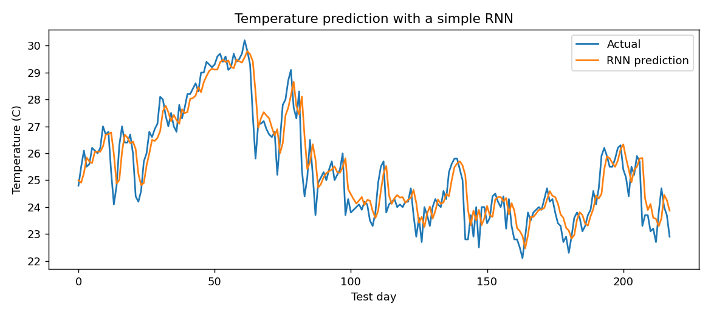
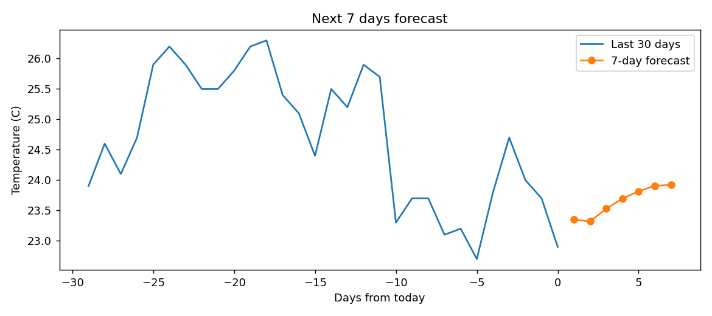

# Temperature Prediction with a Simple RNN

Predicts tomorrow's temperature from the last 7 days using a Recurrent Neural Network (Keras `SimpleRNN`).

## Run it
```
pip install tensorflow numpy matplotlib requests
python temperature_rnn.py
```
You can also paste the code into Google Colab (colab.research.google.com) and run it there. No setup needed.

It prints the average test error and tomorrow's prediction, and saves `result.png` (actual vs predicted).

## How it works
1. Download 3 years of real daily temperatures for Bengaluru from the free Open-Meteo API.
2. Scale values to 0-1.
3. Turn the data into samples: last 7 days -> next day.
4. Train on the first 80% of days, test on the last 20%.
5. A `SimpleRNN` layer reads the 7 days in order and keeps a memory of them. A `Dense` layer outputs the prediction.

## Why an RNN?
Temperature is a sequence: today depends on the days before it. An RNN passes a hidden state from one time step to the next, so it can use earlier days when predicting the next one.

## Data
Real daily temperature data for Bengaluru from the free Open-Meteo API.

## Ideas to extend
- Swap `SimpleRNN` for `LSTM` and compare the error.
- Use real weather data from a CSV file.
- Predict the next 7 days instead of 1.
## Results


It also forecasts the next 7 days and saves forecast.png.
